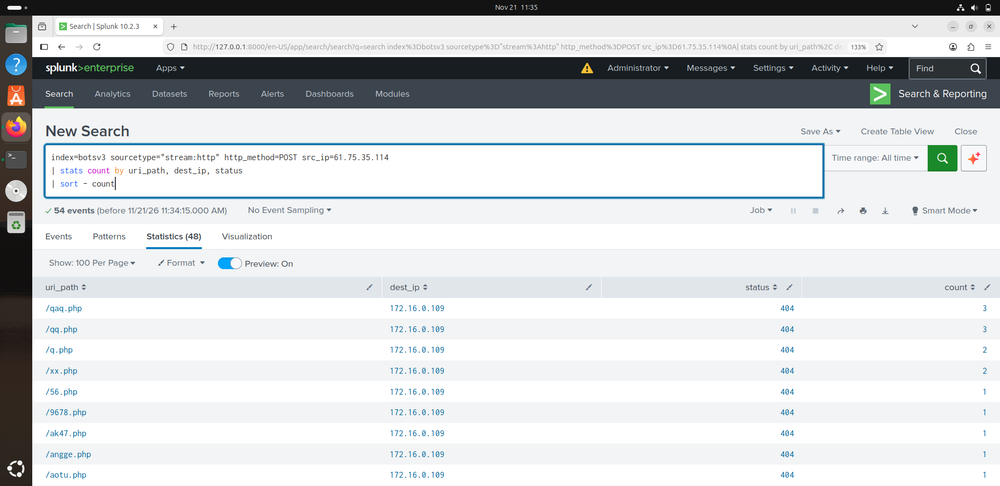
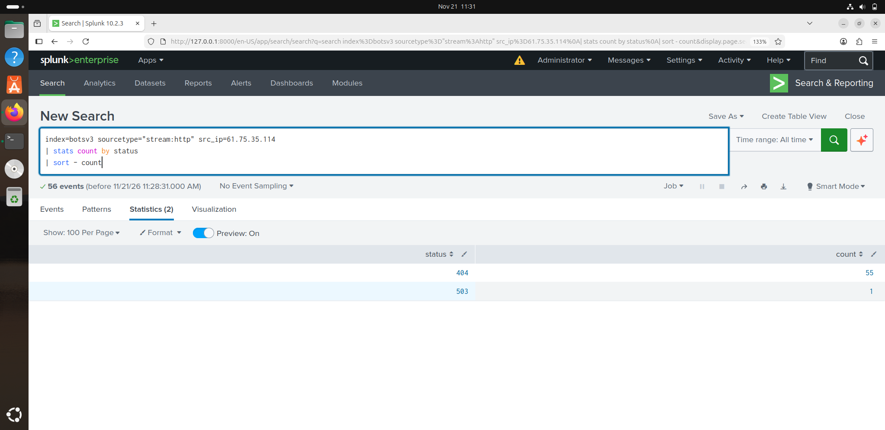
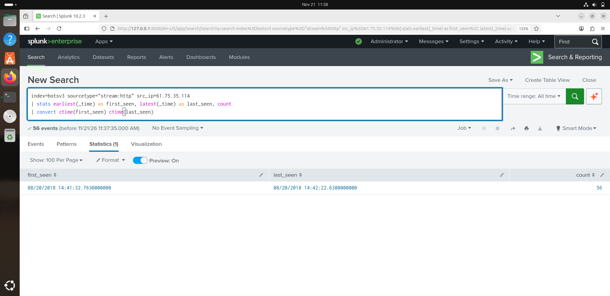

# BOTSv3 — Web Brute-Force / Webshell Scan Investigation

## Executive Summary
Detected and investigated an automated web brute-force / webshell scanning attack originating from external IP `61.75.35.114` targeting internal web server `172.16.0.109`. The attacker attempted to locate a PHP webshell by POSTing to 48 unique guessed filenames over a 50-second window. No webshell was found, and the attack was unsuccessful.

## Key Findings
| Indicator | Value |
| :--- | :--- |
| Attacker IP | 61.75.35.114 |
| Target Host | 172.16.0.109 |
| Attack Window | 2018-08-20 14:41:32 - 14:42:22 UTC |
| Duration | 50 seconds |
| Total Requests | 56 |
| HTTP Method | POST |
| Result | 55x 404, 1x 503, 0x 200 |

## Investigation Methodology

### 1. Initial Triage
Identified anomalous external-to-internal HTTP POST traffic using Splunk:

```spl
index=botsv3 sourcetype="stream:http" src_ip=61.75.35.114
| stats count by uri_path, status
```

## Evidence






## Remediation & Recommendations
1. Block `61.75.35.114` at the perimeter firewall and WAF.
2. Review WAF rules for PHP file enumeration and POST scanning.
3. Alert on >20x 404 responses from a single external IP within 60 seconds.
4. Verify no PHP webshells exist on `172.16.0.109` via file integrity monitoring.

## Tools Used
- Splunk Enterprise (BOTSv3 Dataset)
- SPL (Splunk Processing Language)
- MITRE ATT&CK: T1190 - Exploit Public-Facing Application

## Author
SOC Analyst Investigation — BOTSv3 Lab
